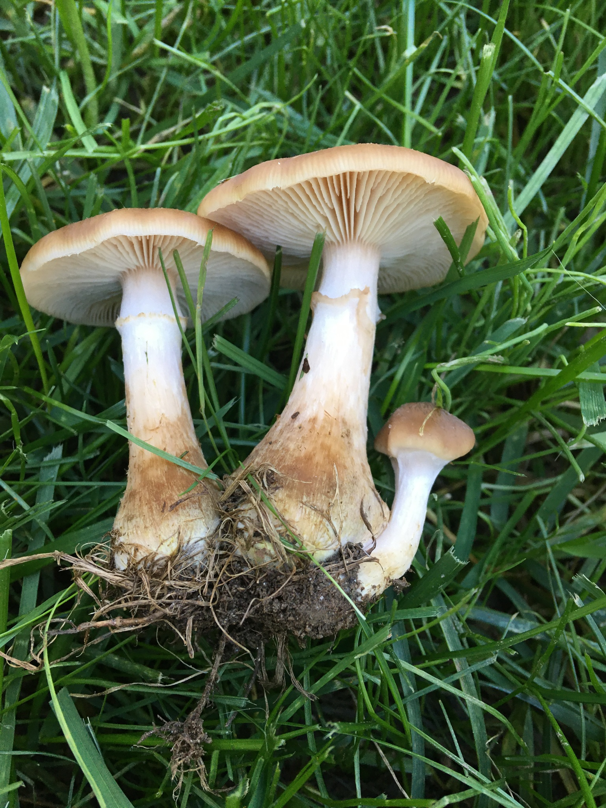
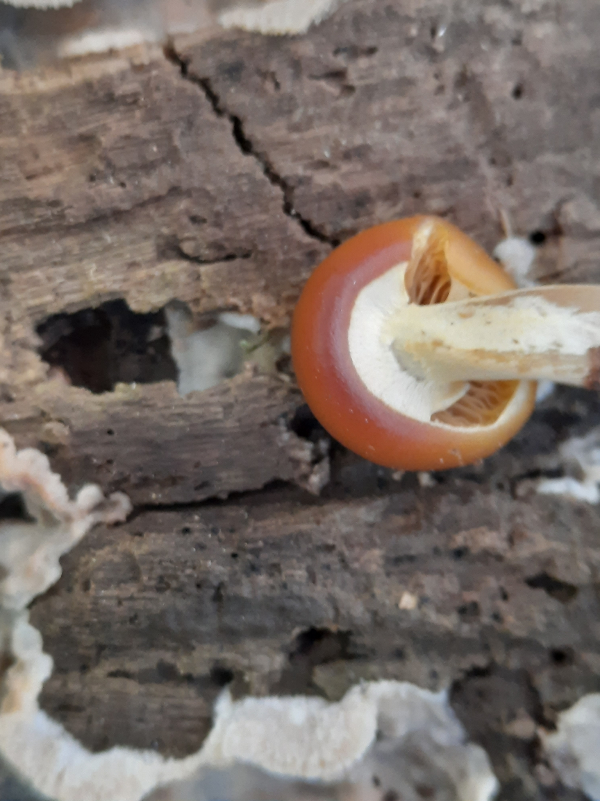

## ⚠ POSITIVE-ID SAFETY GATE

> ⚠ **Honey mushroom vs. deadly galerina — the look-alike grows on the same wood in the same season and can destroy the liver**
>
> **Positive-ID checklist (ALL must hold):**
> - **On wood.** Clusters at the base of a tree or stump, or over buried roots, usually hardwood, sometimes conifer [1][2]. Some honey mushroom species grow alone or in loose groups, so a tight cluster is common but not required [3].
> - **Cap honey-yellow to tan or brown,** often with small dark or yellowish scales near the center [1][2][3].
> - **Whitish gills,** attached to the stem or running down it [1][2].
> - **A ring or ring zone on the upper stem.** It can be thin and white with a yellow edge, or cobwebby and short-lived [1][2][3].
> - **No cup (volva) at the stem base, and gills that attach to the stem rather than stand free,** checked on a mushroom dug up whole, not picked [5]. A swollen base, common on *A. gallica* [3], does not settle whether there is a cup; the expert checks the base.
> - **Black "shoestring" cords (rhizomorphs)** under the bark or in the soil [2][5].
> - **A white spore print from a cap of every cluster you pick** (general practice). A rusty brown print is the galerina result [6][7][8].
> - **Fruiting in fall** [5].
>
> **Do NOT use if ANY of these are present (disqualifying traits):**
> - A spore print that is rusty brown, brown or any color other than white [6][7][8]
> - Gills yellowish at first and turning rusty brown as the spores mature, or a ring or ring zone that is rusty brown [6][7]
> - Bright orange cap, gills and flesh in a large cluster from a stump, tree base or buried wood (jack-o'-lantern) [9]
> - White gills that do not touch the stem, or a cup (volva) at the stem base (the *Amanita* pattern) [5]
> - No ring and no ring zone at all (see ringless look-alikes below), or any mushroom that does not match every checklist item
> - Old, decayed or insect-damaged caps; any bag holding more than one kind of mushroom
>
> **Confusable with:** Deadly galerina (*Galerina marginata*) → rusty brown spore print, gills turning rusty, often a smaller and smoother cap → amatoxin poisoning with a delayed onset and possible liver and kidney failure [6][7][8][10].
>
> **A white print does not finish the job.** It rules out galerina. It does not rule out *Amanita*, which also prints white [5], or any other white-spored wood mushroom.
>
> **This mushroom matches the pattern in doctrine point 3.** The mushroom doctrine (point 3) says no white-gilled mushrooms with a ring or a volva, because that is the *Amanita* pattern [5]. The honey mushroom has whitish gills and a ring, so it falls inside that wording, and a reader who follows point 3 alone would reject it. It is eaten only after an expert has examined the dug-up specimen in hand and has checked the stem base for a cup (volva) and checked whether the gills attach to the stem or stand free [5]. Without that expert check, point 3 applies: do not eat it.
>
> **Verdict:** Positive ID on every checklist item, confirmed by a mushroom expert who has the specimen in hand, or do not eat it. **This species must never be eaten on field identification alone.** Photos and descriptions are never enough.

---

## ☠ Deadly Look-Alikes

### Deadly galerina (*Galerina marginata*)

Missouri lists the honey mushroom's look-alike as the deadly galerina: "smaller, smooth cap, brown spores" [1]. Volk says galerina is picked by accident along with honey mushrooms and that the danger is putting a few into the basket with the edible ones [8]. Compare:

| Check | Honey mushroom | Deadly galerina |
|---|---|---|
| Spore print | White [1][2][3] | Rusty brown [6][7][8] |
| Gills | Whitish, may darken or spot pinkish to brownish with age [1][2] | Yellowish, becoming rusty brown [6][7] |
| Ring | Thin white ring, sometimes with a yellow edge, or short-lived [2][3] | Thin, whitish to rusty brown, collapsed and bracelet-like; some have only a ring zone or none [7] |
| Cap | 3 to 12 cm; tiny scales common at the center [2][3] | 1.5 to 5 cm, sticky when wet, fading to two tones as it dries [7] |
| Stem | Tough and fibrous, whitish becoming reddish brown below [1] | Dark brown to reddish brown from the base up [7] |
| Where | Wood, buried wood, black cords on the roots [2][5] | Rotting hardwood and conifer wood, or buried wood so it looks like it grows from soil [6][7] |

The size ranges overlap, honey mushroom gills can darken, and both can have a ring. Only the spore print and the whole set of traits separate them. Galerina fruits mostly in spring and fall and is found year-round, usually in clusters, sometimes alone [6][7]. Kuo calls it widely distributed and common in North America, with illustrated collections from Illinois, Colorado and Quebec; the sources opened give no New England range for it [7].

### Other rusty-spored and brown-spored wood mushrooms

- Big laughing gym (*Gymnopilus junonius*): orange, bitter, orange-brown spores [1][9].
- *Pholiota*: dark brown print, often a scaly cap. Wood-growing *Hypholoma*: usually larger, dark brown to purplish brown print [7].
- The NAMA case registry and syndromes page record illness from these [10][11]. *Gymnopilus spectabilis* (the registry's name; 15 adults, with reports from Massachusetts, New York and Rhode Island among the places) caused hallucinations in 10 of the 15 cases, with stomach distress, anxiety, paranoia and disorientation also listed, and NAMA places *Gymnopilus* in its hallucinogen (indole) group. The sources opened do not say whether the registry's *G. spectabilis* is the Missouri big laughing gym (*G. junonius*), so treat every orange wood mushroom alike. *Pholiota squarrosa* (12 adults, reported from Alberta, Colorado, Minnesota, Montana and Wyoming, not New England) caused stomach distress (severe in two) and fever in three. *Hypholoma sublateritium* has one registry entry, a child with cramps. Volk calls the idea that any mushroom growing on wood is edible "definitely not true" [8]. Treat all as not for eating.

### Jack-o'-lantern (*Omphalotus illudens*)

Orange all through, with true gills, in large clusters on stumps, tree bases and buried wood, July to October [9]. Missouri names it as a honey mushroom look-alike [1]. It causes severe stomach illness (see Toxicology). See the [chanterelle entry](chanterelle-new-england.md) for its details.

### Ringless relatives and *Amanita*

Missouri lists a ringless honey mushroom (*Desarmillaria caespitosa*) with a dry cap and no ring, and velvet foot (*Flammulina velutipes*) with no ring and white spores [1][6]. A clump with no ring or ring zone is outside this entry, which gives no basis to eat one. The *Amanita* pattern (ring, cup at the base, free white gills, white print) is covered by [5] and the [amatoxin hazard entry](../../../mid-atlantic-appalachian/hazards/entries/amatoxin-mushrooms-amanita-galerina.md). That entry is Mid-Atlantic-scoped, but amatoxin toxicology is not tied to a region. Dig up mushrooms rather than picking them so the base can be checked for a cup [5]. A swollen stem base, which *A. gallica* often has [3], does not tell you whether a cup is there; the expert checks the dug-up base.

The Abortive Entoloma (*Entoloma abortivum*) is what honey mushroom fruit bodies become when that fungus parasitizes them; they turn misshapen [5]. This entry gives no basis to eat it.

---

## Identification

*Supporting evidence, never sufficient for ID. A single photo. Source and license: `_media/SOURCES.md`.*

*The deadly look-alike. Supporting evidence, never sufficient for ID. Source and license: `_media/SOURCES.md`.*

**Cap:** golden yellow when young and fresh, fading to yellowish or brownish; mostly bald, sometimes with tiny scales near the center [2]. Missouri describes black hairy scales at the center [1].

**Gills and ring:** whitish gills, covered at first by a pale yellow to whitish veil that leaves a thin white ring, often with a yellow edge [2]. *A. gallica* often has a flimsy ring or only a yellow ring zone and a swollen stem base [3].

**Stem:** tapers toward the base where clustered stems fuse [2]; tough and fibrous [1].

**Rhizomorphs:** long black cords that spread the fungus through wood and from tree to tree [2].

**Spore print:** white [1][2][3][5].

**Which species:** Kuo says some species cannot be told apart by looks and must be "mated" in a lab, and that *A. gallica* and *A. calvescens* remain basically inseparable in some areas [2][3]. The Forest Service says species can be distinguished only with laboratory techniques [5]. Kuo treats *A. ostoyae* as a Eurasian species and says the name was once applied to the North American *A. solidipes* [4]. Which species a New England clump belongs to is not something the sources opened settle. This entry covers the group.

**Smell, color, insect damage:** NAMA says color, insect damage, smell and folklore are not reliable tests of edibility [15].

---

## Habitat, Substrate & Fruiting (this biome)

- **Grows on:** living, stressed or dead wood. The Forest Service guide for Midwest and Northeast forests lists the honey mushroom as a root and butt rot that can kill trees, especially stressed ones, and as a cause of root rot in pine [5]. Keep this in mind in a woodlot, yard or orchard: a clump means a tree may be infected.
- **Season:** fall [5]. Kuo says clusters appear in the fall after rains, and *A. gallica* fruits late, in cold weather in late fall and early winter [2][3]. Peak weeks for New England were not found in a source opened and are left out.
- **Range:** the Forest Service guide covers Midwest and Northeast forests [5]. Kuo lists *A. mellea* across eastern North America and *A. gallica* east of the Rocky Mountains, with *A. calvescens* more northerly [2][3]. The NAMA case registry includes honey mushroom stomach-illness reports from Maine, New York, Pennsylvania and Vermont among other places [11].

---

## ⚠ MANDATORY PREPARATION

Missouri calls the honey mushroom a good edible when young and fresh that causes stomach upset in some people [1]. The Forest Service guide rates it "Choice" for *A. gallica* and "Edible" for *A. solidipes* [5]. The NAMA registry lists 38 or more adults with stomach illness from the *A. mellea* group, with an average onset of about 4 hours (range 0.2 to 11 hours); its authors note the group is a complex of species and that spoiled mushrooms confuse the picture [11]. Stomach upset in some people is reported even from young, fresh mushrooms [1], so tolerance varies from person to person.

1. Confirm every item in the gate on every cluster, including a white spore print. Have a mushroom expert confirm the collection first.
2. Use only young, fresh caps. Throw out old, decayed or insect-damaged ones.
3. **Blanch first and throw the cooking water away.** Tox Info Suisse, a national poisons centre, lists honey fungus (*Armillaria mellea* and *A. ostoyae*) under "blanch, throw away cooking water," and says skipping the step risks vomiting and diarrhoea 1 to 4 hours after the meal [19]. It gives no blanching time for honey fungus, and no other source opened does, so none is given here. Blanch means boiling the mushrooms in a pot of water, then pouring that water off and cooking them again in fresh liquid (general practice). The same page says most mushrooms need at least 10 minutes of cooking [19].
4. **Then cook thoroughly** [1]. No source opened gives a cooking time or temperature for honey mushroom, so none is given here. Do not eat raw [1][19].
5. **Eat only a small amount the first time** [1]. A small portion does not clear a doubtful ID: amatoxin poisoning can show no symptoms for 6 to 24 hours [10].
6. **Skip alcohol.** NAMA lists the *A. mellea* group under "Other Alcohol-Induced Syndromes," with stomach distress in susceptible individuals and a delay of up to 5 hours [10]. The registry records four beer drinkers who were much sicker than the others in one group [11].
7. Keep one species per container. Never mix collections.
8. If anything about the ID is in doubt, do not eat it.

---

## Toxicology of the Confusables

### Deadly galerina (amatoxin)

- **Toxin:** the same toxin as the destroying angels [8][10].
- **Onset and course:** Missouri says symptoms can begin 10 or more hours after eating, with vomiting, diarrhea and cramps that may ease for a while, then kidney or liver failure and possibly death [6]. NAMA describes a latency of 6 to 24 hours, violent vomiting and diarrhea, a day in which the victim seems to recover, then relapse with kidney and liver failure. A patient may seem recovered on day two or three and be sent home [10]. Volk says death often follows if a liver transplant or other heroic measures are not performed [8].
- **How deadly:** sources differ. NAMA gives a death rate of about 50% without prompt, knowledgeable medical treatment and about 10% in the U.S. and Canada [10]. CDC puts amatoxin (*Amanita phalloides*) poisoning at 10% to 20% [13].
- **Cooking:** cooking does not make a poisonous mushroom edible [12].

### Jack-o'-lantern

Nausea and vomiting usually start 1 to 3 hours after the meal, and most victims recover within 12 hours [10]. Missouri says it makes people very sick for a few days and is not life-threatening to healthy adults [9]. Fluid and electrolyte loss from vomiting and diarrhea is the danger [10].

### If someone may have eaten a look-alike

This is commonly taught first aid for when help is slow to arrive, not medical advice.

1. **Call Poison Help, 1-800-222-1222, now** [12][14]. A poison center works with mycologists on identification [12]. Do not wait for symptoms. NAMA likewise says not to wait for symptoms to become severe [15].
2. **Call 911** if the person collapses, has a seizure, has trouble breathing, or cannot be woken [14].
3. **Do not make the person vomit** [14].
4. **Keep photos or specimens** of what was eaten [15]. Tell them what was eaten, when and how much.

---

## Legal note

Picking is regulated and the rule differs by land manager. On Vermont Department of Forests, Parks and Recreation lands, mushrooms may be collected only for personal use at the collector's risk, and commercial harvest needs a special written permit [16]. Acadia National Park prohibits taking mushrooms [17]. In New Hampshire, someone harvesting wild mushrooms for personal use does not need a license, while selling to food establishments requires a licensed harvester [18]. That is a food-sale rule, not a land rule. On New Hampshire DRED properties, and on state parks in the operating season, Res 7301.05 bars removing, damaging or disturbing any plant; the rule text does not say whether mushrooms count, so ask DRED before picking on state land [20]. The sources opened do not cover the other New England and New York state lands, so check the agency (state forests and parks, national forests, town and land-trust land) before picking. No survival exemption was found.

---

## Sources

1. Honey Mushroom (Armillaria mellea). Missouri Department of Conservation. https://mdc.mo.gov/discover-nature/field-guide/honey-mushroom [T1; identification and edibility statements only, not a New England source]
2. Armillaria mellea. MushroomExpert.Com (Michael Kuo). https://www.mushroomexpert.com/armillaria_mellea.html [T2, identification only]
3. Armillaria gallica. MushroomExpert.Com (Michael Kuo). https://mushroomexpert.com/armillaria_gallica.html [T2, identification only]
4. Armillaria ostoyae. MushroomExpert.Com (Michael Kuo). https://mushroomexpert.com/armillaria_ostoyae.html [T2, identification only]
5. Field Guide to Common Macrofungi in Eastern Forests and Their Ecosystem Functions (GTR NRS-79, rev. 2012). USDA Forest Service, Northern Research Station. https://www.nrs.fs.usda.gov/pubs/gtr/gtr_nrs79r.pdf [T1]
6. Deadly Galerina (Galerina marginata). Missouri Department of Conservation. https://mdc.mo.gov/discover-nature/field-guide/deadly-galerina [T1]
7. Galerina marginata. MushroomExpert.Com (Michael Kuo). https://mushroomexpert.com/galerina_marginata.html [T2, identification only]
8. Tom Volk's Fungus of the Month for May 2003 (Galerina autumnalis). University of Wisconsin-Madison Botany (hosted). https://botit.botany.wisc.edu/toms_fungi/may2003.html [T2]
9. Jack-o'-Lantern. Missouri Department of Conservation. https://mdc.mo.gov/discover-nature/field-guide/jack-o-lantern [T1]
10. Mushroom Poisoning Syndromes. North American Mycological Association. https://www.namyco.org/mushroom_poisoning_syndromes.php [T2]
11. Thirty-Plus Years of Mushroom Poisoning (Beug, Shaw, Cochran). McIlvainea 16(2), 2006. North American Mycological Association. https://namyco.org/wp-content/uploads/2023/08/Poisonings30year.pdf [T2]
12. Mushroom poisoning: Don't invite "the death angel" to dinner. America's Poison Centers. https://www.poison.org/articles/wild-mushroom-warning [T1]
13. Amanita phalloides Mushroom Poisonings, Northern California, December 2016. CDC, MMWR 66(21). https://www.cdc.gov/mmwr/volumes/66/wr/mm6621a1.htm [T1]
14. First Aid for Poisonings. National Capital Poison Center. https://www.poison.org/first-aid-for-poisonings [T1]
15. Wild Mushroom Safety. North American Mycological Association. https://namyco.org/?p=163236 [T2]
16. Rules and Regulations, Visitor Conduct (effective 08/24/2022). Vermont Department of Forests, Parks and Recreation. https://www.vtstateparks.com/sites/stateparks/files/documents/rules_current.pdf [T1]
17. Park Rules and Regulations, Acadia National Park. National Park Service. https://www.nps.gov/acad/planyourvisit/park-rules-and-regulations.htm [T1]
18. Foraged Mushrooms Safety and Quality. University of New Hampshire Extension. https://extension.unh.edu/blog/2023/10/foraged-mushrooms-safety-quality [T1]
19. Edible mushrooms: unpleasant gastrointestinal symptoms (last update May 2025). Tox Info Suisse (Swiss national poisons centre). https://toxinfo.ch/edible_mushrooms_unpleasant_gastrointestinal_symptoms [T2; preparation statement only, not a North American source]
20. Res 7301.01 and Res 7301.05 (Res 7300 rules, DRED properties and state parks). New Hampshire General Court, Administrative Rules. https://gc.nh.gov/rules/state_agencies/res7300.html [T1]
